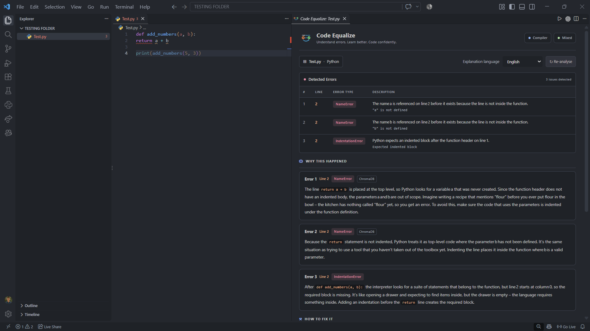
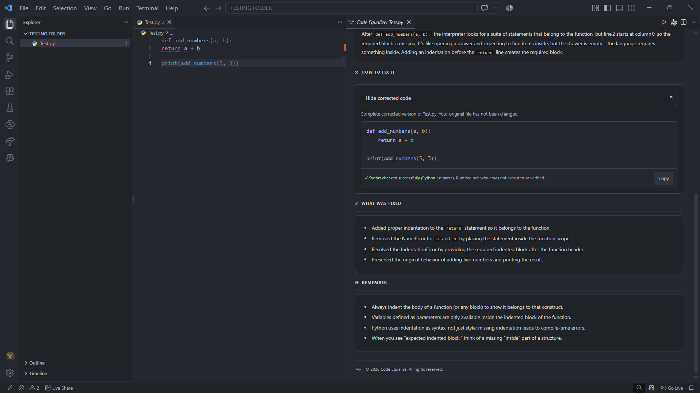
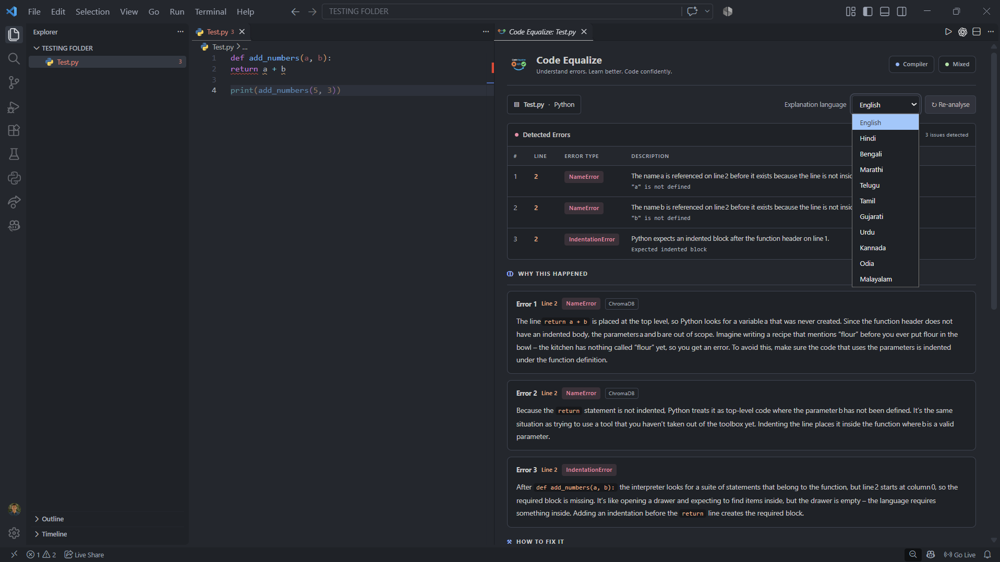
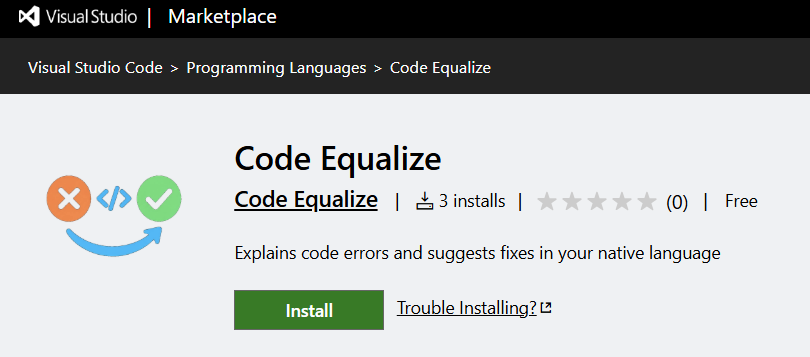

# Code Equalize

<p align="left">
  
</p>

**Understand coding errors in your preferred language.**

Code Equalize is an AI-powered Visual Studio Code extension that helps developers understand programming errors through simplified, context-aware explanations in their preferred language. It aims to make debugging more accessible, educational, and beginner-friendly.

[**View on VS Code Marketplace**](https://marketplace.visualstudio.com/items?itemName=code-equalize.code-equalize) | [**GitHub Repository**](https://github.com/CodeEqualize/code-equalize)

---

## Screenshots

### Extension Interface



### Error Explanation and Corrected Code Suggestions



### Language Selection



### VS Code Marketplace




---

## Problem

Programming errors can be difficult to understand, especially for beginners. Compiler and runtime messages are often technical and presented primarily in English, creating a learning barrier for students and aspiring developers.

## Solution

Code Equalize uses AI to analyse programming errors, retrieve relevant contextual knowledge, and provide simplified explanations in the developer's preferred language while preserving technical accuracy.

## Features

- **AI-assisted debugging:** Analyse programming errors and generate clear explanations.
- **Multilingual explanations:** Understand errors in 11 different languages.
- **Context-aware suggestions:** Receive relevant explanations based on available code context.
- **Retrieval-Augmented Generation (RAG):** Retrieve relevant programming knowledge to improve response quality.
- **ChromaDB integration:** Store and retrieve contextual programming knowledge.
- **Whole-source analysis:** Identify related errors and help understand their root causes.
- **Corrected code suggestions:** Receive suggested corrections alongside explanations.
- **Syntax validation:** Validate corrected code syntax before presenting suggestions.
- **Beginner-friendly guidance:** Make complex programming errors easier to understand.

## Supported Programming Languages

Code Equalize currently supports error analysis for:

- Python
- Java
- C
- C++

## Supported Explanation Languages

Explanations can be provided in the following 11 languages:

1. English
2. Hindi
3. Bengali
4. Marathi
5. Telugu
6. Tamil
7. Gujarati
8. Urdu
9. Kannada
10. Odia
11. Malayalam

## Technology Stack

| Component | Technology |
|---|---|
| Extension | TypeScript |
| Editor Integration | VS Code Extension API |
| Backend | Node.js, Express.js |
| AI Inference | Groq API |
| AI Model | `openai/gpt-oss-120b` |
| Vector Database | ChromaDB |
| Hosting | Railway |

## Installation

1. Open Visual Studio Code.
2. Navigate to the Extensions view (`Ctrl + Shift + X`).
3. Search for **Code Equalize**.
4. Select Code Equalize and click **Install**.

Alternatively, install it directly from the [VS Code Marketplace](https://marketplace.visualstudio.com/items?itemName=code-equalize.code-equalize).

An active internet connection is required to communicate with the hosted backend.

## Usage

1. Open a supported programming file in VS Code.
2. Right-click in the editor and choose **Explain with Code Equalize**.
3. Alternatively, open the Command Palette using `Ctrl + Shift + P`.
4. Search for **Code Equalize: Explain in My Language**.
5. Follow the extension's prompts to receive an explanation in your preferred language.

## System Architecture

Code Equalize consists of a VS Code extension connected to a hosted backend. The backend integrates AI-powered explanation generation with ChromaDB-based knowledge retrieval.

```text
VS Code Extension (TypeScript)
          |
          v
Railway Backend (Node.js / Express)
          |
          +---- Groq API
          |     (AI explanation generation)
          |
          +---- ChromaDB
                (RAG knowledge retrieval)
```

## Backend and Deployment

The Code Equalize backend is deployed on **Railway**.

The production deployment consists of:

- **Backend service:** Node.js and Express API responsible for processing requests and generating explanations.
- **ChromaDB service:** Vector database used to store and retrieve contextual programming knowledge.
- **Persistent storage:** Railway volume used to retain ChromaDB data.

The extension communicates with the hosted backend, so users do not need to install or configure the backend or database locally.

## Repository

[GitHub – Code Equalize](https://github.com/CodeEqualize/code-equalize)

## License

This project is licensed under the MIT License. See the [LICENSE](LICENSE) file for details.

## Project Status

Code Equalize was developed as an academic major project with the goal of improving programming accessibility and helping developers understand, learn from, and resolve coding errors more effectively.

The extension is publicly available on the Visual Studio Code Marketplace and connects to a hosted production backend.

## Release Notes

See [CHANGELOG.md](CHANGELOG.md) for version history and updates.